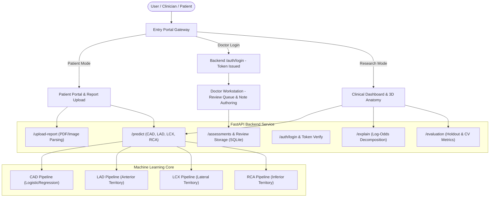

# CardioVision AI — Master Implementation Plan
## Multimodal AI Hackathon 2026 | Track A: Cardiovascular Risk Visualization & Prediction

---

### Executive Summary

CardioVision AI is an end-to-end full-stack medical AI research platform combining:
1. **Multi-Target Coronary Artery Disease & Vessel-Specific Stenosis Classification:**
   - Overall CAD probability (binary presence of angiographic disease).
   - 3-Vessel territory predictions: **LAD** (Left Anterior Descending), **LCX** (Left Circumflex), and **RCA** (Right Coronary Artery).
   - Strict target-leakage controls: all models predict from the baseline 13 clinical features without target leakage or circular catheterization dependencies.
2. **Interactive 3D Cardiovascular Anatomy & Vessel Risk Explorer:**
   - Three.js/React Three Fiber 3D heart with Torso Mediastinum silhouette, Isolated Heart, and Coronary Focus views.
   - Dynamic risk visualization: real-time color-coding of LAD, LCX, and RCA based on patient predictions (<30% green, 30-69% amber, >=70% red).
   - Synchronized anatomical callouts, territory definitions, and interactive camera controls.
3. **Dedicated Entry Portal Gateway & Secure Doctor Authentication:**
   - Welcome landing gateway distinguishing Patient Portal (session-based, plain-English, report upload) from Doctor Workstation.
   - Backend-authenticated Doctor Login (`POST /auth/login`), hashed credentials in SQLite, session/bearer token verification, and route protection for clinical review endpoints.
4. **Clinical Report Parsing & Confirmation Workflow:**
   - PDF and report upload with extraction of resting blood pressure, cholesterol, fasting glucose, heart rate, and ST depression.
   - Human-in-the-loop confirmation modal before committing parameters.
5. **Real-Time Explainable AI (XAI):**
   - Exact log-odds contribution decomposition, global feature importance ranking, and mathematical logit-probability audit.
6. **Empirical Model Evaluation:**
   - Holdout metrics (ROC-AUC, Precision, Recall, Sensitivity, Specificity, F1, Accuracy), 5-fold cross-validation, 2x2 confusion matrix, ROC curve, and calibration reliability bins.

---

### Architecture & Data Flow

---

### Implementation Phases

1. **Phase 1: Implementation Documentation & Tracking**
   - Establish `IMPLEMENTATION_PLAN.md` and `IMPLEMENTATION_CHECKLIST.md`.
2. **Phase 2: Multi-Target ML Models (CAD, LAD, LCX, RCA)**
   - Train 4 separate pipelines with strict zero-leakage guarantee on UCI Cleveland dataset.
   - Export evaluation metrics for all 4 targets in `models/evaluation.json` and pipelines in `models/cardiovision_pipeline.joblib`.
   - Update `model_service.py` and `schemas.py` to return vessel-specific predictions.
3. **Phase 3: Backend Doctor Authentication & Route Protection**
   - Add SQLite credentials store with salted password hashing.
   - Implement `POST /auth/login` and auth dependency for protected doctor endpoints.
   - Seed default demo clinician account (`doctor@cardiovision.ai` / `CardioVision2026!`).
4. **Phase 4: Dynamic 3D Coronary Artery Risk Visualization**
   - Connect predicted LAD, LCX, RCA probabilities directly to `AnatomyExplorer.tsx`.
   - Render dynamically color-coded vessel tracts, interactive vessel selection, and myocardial territory callouts.
5. **Phase 5: Entry Portal Selection & Doctor Login Experience**
   - Create `EntryPortalPage.tsx` with dedicated Patient Portal, Doctor Login, and Research Explorer paths.
   - Add login dialog/form with real API token handshake and session persistence.
6. **Phase 6: Quality Assurance, Automated Tests & Packaging**
   - Run backend `pytest` suite.
   - Run frontend `vitest` suite and `npm run build`.
   - Generate production distributable `CardioVisionAI.zip`.
