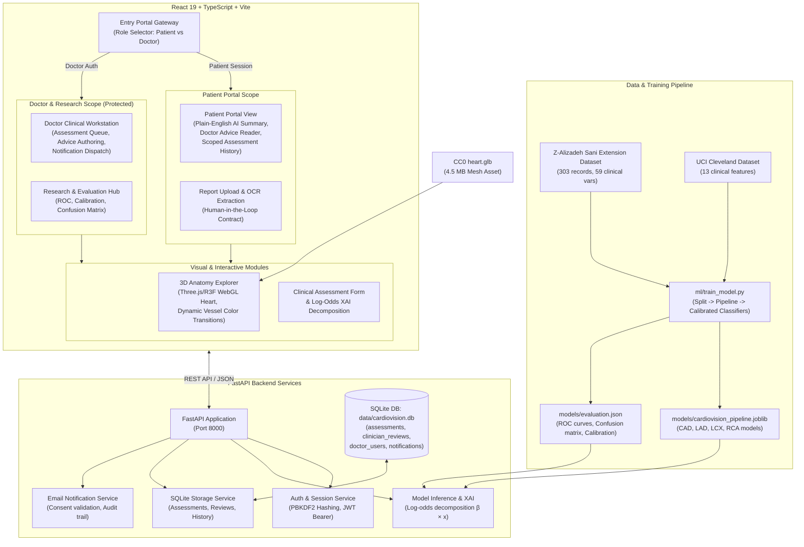

# CardioVision AI — Architecture & System Design

CardioVision AI is an end-to-end multimodal cardiovascular research platform developed for the **Multimodal AI Hackathon 2026 — Track A: Cardiovascular Risk Visualization & Prediction**.

---

## 1. System Architecture Diagram

---

## 2. Component Architecture

### 2.1 Backend Services (`backend/app/`)
- **`main.py`:** REST API router with CORS configuration. Implements strict role-based route protection via FastAPI dependencies (`get_current_doctor`).
- **`model_service.py`:** Encapsulates the multi-target scikit-learn pipeline. Implements local feature attribution via exact log-odds decomposition:
  $$\text{logit}(p) = \beta_0 + \sum_{i=1}^m \beta_i x_i$$
- **`storage_service.py`:** Handles SQLite schema migrations and atomic transactions for assessments, physician reviews, notifications, and doctor user accounts.
- **`notification_service.py`:** Validates recipient email, verifies patient consent flags, dispatches follow-up emails via SMTP or dev sink, and records delivery status.

### 2.2 Machine Learning Architecture (`ml/`)
- **Multi-Target Classification:** Rather than estimating only overall CAD, four distinct calibrated classifiers predict:
  1. **Overall CAD**
  2. **LAD Stenosis** (Left Anterior Descending)
  3. **LCX Stenosis** (Left Circumflex)
  4. **RCA Stenosis** (Right Coronary Artery)
- **Zero Target Leakage Guarantee:**
  - Target labels (`Cath`, `CAD`, `LAD`, `LCX`, `RCA`) are stripped prior to feature matrix construction.
  - Data splitting (Stratified 80/20 train/test split) occurs **strictly before** any imputer, scaler, or encoder fitting.
  - Test set data is transformed solely using parameters estimated on the training split.

### 2.3 3D Cardiovascular Visualization (`src/components/AnatomyExplorer.tsx`)
- **WebGL Rendering:** Powered by React Three Fiber and Three.js with dampening `OrbitControls`.
- **Dynamic Shader & Material Color Mapping:**
  - Parsed coronary meshes (`Anterior interventricular artery` for LAD, `Right marginal coronary artery` for RCA).
  - Material instances are dynamically cloned and tinted based on real-time inference output probabilities:
    - **Teal / Normal (`#14b8a6`):** $< 30\%$ risk
    - **Amber / Intermediate (`#f59e0b`):** $30\% – 69\%$ risk
    - **Coral / Elevated (`#f43f5e`):** $\ge 70\%$ risk
- **Anatomical Presets:** Seamless camera interpolation between *Torso Mediastinum Silhouette*, *Isolated Heart*, and *Coronary Focus*.

---

## 3. Security & Access Control Model

1. **Role Separation:**
   - Patients access the system through private session identifiers (`patient_session_id`).
   - Doctors authenticate via `/auth/login` using salted PBKDF2 hash verification and bearer session tokens.
2. **Endpoint Protection:**
   - `GET /assessments` (the full clinical patient worklist) is protected by `Depends(get_current_doctor)`. Unauthorized callers receive `401 Unauthorized`.
   - `GET /patients/{session_id}/assessments` is strictly scoped to the requesting patient's private session.
3. **Medical Report OCR Safety:**
   - Extracted laboratory and clinical values are marked with an unconfirmed computational badge.
   - Values are never automatically committed into patient history without explicit user review and confirmation.
